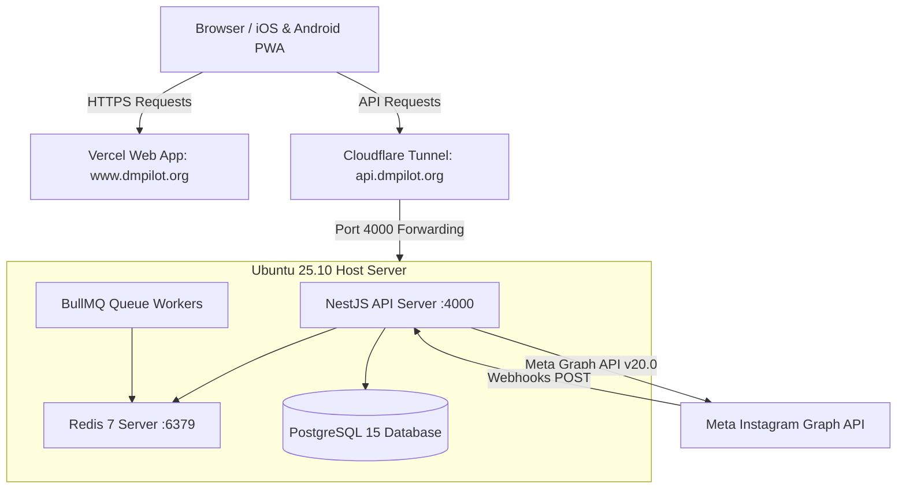
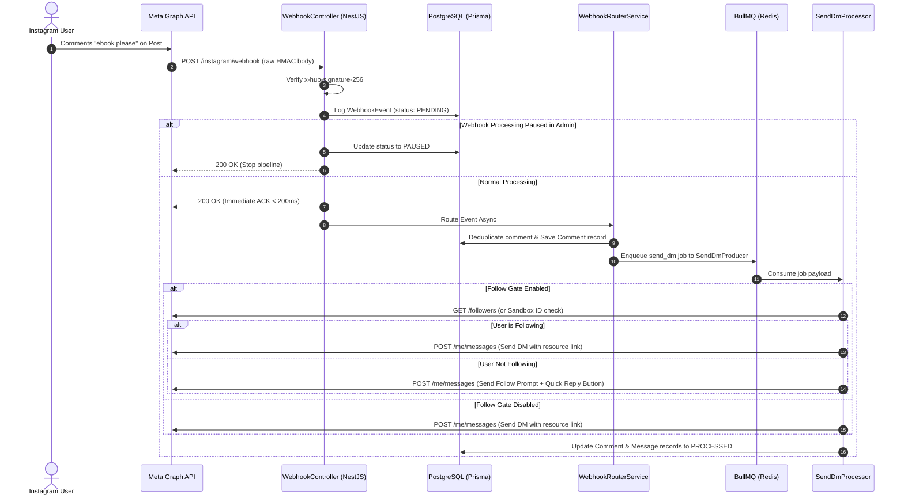

# System Architecture Document — AutoDM (Instagram Business OS)

## 1. System High-Level Topology & Production Hosting

AutoDM is deployed on a hybrid cloud/on-prem infrastructure:



### Infrastructure Components:

- **Frontend Hosting (Vercel)**: Serves `https://www.dmpilot.org` directly from Vercel's global edge network. Manages static generation, server-side rendering, NextAuth authentication callbacks, and client-side state.
- **Backend Host (Ubuntu 25.10 Lab PC)**: Runs the NestJS API server on port `4000`, along with PostgreSQL (database) and Redis (queue broker).
- **Cloudflare Tunnel (`cloudflared`)**: Routes inbound HTTPS traffic from `https://api.dmpilot.org` to `localhost:4000` on the Ubuntu lab PC without exposing public ports or requiring a static IP.
- **Meta Graph API & Webhooks**: Inbound webhooks from Instagram/Facebook hit `https://api.dmpilot.org/instagram/webhook` via Cloudflare, reaching the NestJS engine in under 150ms.

---

## 2. Meta App Review Approval & Permissions Architecture

AutoDM has been **officially approved by Meta App Review** for advanced production access:

### Approved Scopes & Permissions:

- **`instagram_business_basic`**: Read account profile metadata, follower metrics, and media feed.
- **`instagram_business_manage_messages`**: Send and receive direct messages, interactive Quick Replies, and conversational responses.
- **`instagram_business_manage_comments`**: Subscribe to real-time comments on posts/reels and dispatch automated public comment replies under user threads.
- **`pages_show_list` & `pages_read_engagement`**: Read connected Facebook Pages and access Instagram business channel tokens.

### Webhook Event Subscriptions:

- `messages`: Incoming direct messages and customer inquiries.
- `messaging_postbacks`: User interactions with Quick Reply buttons (e.g., "I am following! 📖").
- `feed` & `comments`: Public comments posted on Instagram media, triggers keyword analysis and comment reply dispatch.

---

## 3. Meta Platform Compliance & Data Deletion Architecture

To ensure strict compliance with Section 3(d)(i) of the Meta Platform Terms and India DPDP Act 2023:

1. **Meta Data Deletion Callback URL (`POST /api/auth/data-deletion`)**:
   - Meta posts a signed request containing the user ID when an Instagram user removes the app from their Facebook/Instagram settings.
   - The endpoint validates the HMAC-SHA256 signature using `META_APP_SECRET`.
   - Purges user identifiers and connected Instagram tokens or schedules complete account removal.
   - Responds to Meta with a JSON payload containing a unique `confirmation_code` and status verification URL: `https://www.dmpilot.org/data-deletion-status?code=<confirmation_code>`.
2. **Admin Bulk Data Deletion Panel (`/admin` -> Data Deletion)**:
   - Built-in admin utility allowing system administrators to paste a batch of Meta app-scoped user IDs or instant game IDs (from Meta compliance audit notices) to delete all matching database records in 1 click.
3. **Admin Direct Creator Deletion (`DELETE /admin/creators/:id`)**:
   - Enables administrators to permanently delete any creator account directly from the Admin Panel.
   - Triggers cascading database purge removing all associated campaigns, posts, keywords, connected Instagram channels, comments, messages, follower history, settings, subscriptions, and invoices.
   - Enforces administrative safety (blocks self/admin deletion) and logs action to `AuditLog`.

---

## 4. Webhook Audit & Failure Correlation Engine

Every incoming Meta webhook event undergoes real-time trace correlation:

```prisma
model WebhookEvent {
  id           String        @id @default(uuid())
  provider     String        @default("META")
  eventId      String?       @unique
  payload      Json
  status       WebhookStatus @default(PENDING) // PENDING, PROCESSED, FAILED, PAUSED
  errorMessage String?
  commentId    String?
  username     String?
  senderId     String?
  fbtraceId    String?
  createdAt    DateTime      @default(now())
  updatedAt    DateTime      @updatedAt

  @@index([status])
  @@index([createdAt])
  @@index([commentId])
  @@index([fbtraceId])
}
```

### Audit Log Features & Scoping Rules

- **User-Scoped Creator Access**: Creator users only view webhooks matching their connected Instagram accounts (`userId` scope).
- **Dedicated Admin Audit Tab**: Dedicated "Webhooks Audit" tab in the Admin Panel (`/admin` -> Webhooks tab) for global system inspection.
- **Live Audit Log Table**: Displays `Time | Comment ID | User | Send Status | Error Diagnostic | fbtrace_id`.
- **Meta `fbtrace_id` Capture**: Captures the unique `x-fb-trace-id` header and JSON `error.fbtrace_id` returned by Meta for direct correlation with Meta Developer Support tickets.
- **Global Webhook Pause Switch**: Enables 1-click system-wide webhook processing pause/resume.
- **Timeframe Purge Controls**: Supports selective log deletion (`All Time`, `Older than 24 hours`, `Older than 7 days`, `Older than 30 days`).
- **Failed Jobs Purge & Refresh**: Supports timeframe purging for failed jobs in BullMQ queues and `QueueJob` database records.

---

## 5. Technology Stack & Monorepo Structure

AutoDM is structured as a PNPM Monorepo managed via workspace dependencies:

```text
AutoDM/
├── apps/
│   ├── api/             # NestJS 10 REST API, Prisma ORM, BullMQ Processors
│   └── web/             # Next.js 14 App Router, NextAuth.js, TailwindCSS, Framer Motion
└── packages/
    ├── config/          # Shared ESLint, Prettier, and tsconfig presets
    ├── types/           # Shared TypeScript interfaces (ApiResponse, ApiErrorResponse, UserDto)
    └── ui/              # Monorepo UI library (Button, Dialog, Input, Tailwind Preset, Tokens)
```

### Technology Matrix:

- **Frontend Layer**: Next.js 14 (App Router), React 18, TailwindCSS (Sejda-inspired light theme), Framer Motion, TanStack React Query, NextAuth.js (JWT strategy), Lucide React.
- **Theme & Design Tokens**: Centralized CSS variables in `packages/ui/src/index.css` mapped in `packages/ui/src/tailwind.preset.js` (`#FAF9F5` canvas, crisp `#FFFFFF` surfaces, emerald-to-cyan primary brand gradient).
- **Backend Layer**: NestJS 10, TypeScript 5, Passport.js (JWT Strategy), Zod (config validation), Class Validator, Nodemailer / Resend.
- **Database & Persistence**: PostgreSQL 15, Prisma ORM 5 (`prisma-client-js`), Redis 7 (`ioredis`).
- **Queue & Background Processing**: BullMQ 5 (`@nestjs/bullmq`) backed by Redis.
- **Payment Gateway**: Razorpay Node.js SDK (`razorpay.paymentLink.create`).

---

## 6. Dynamic Webhook Event Pipeline

When an Instagram commenter interacts with a post or sends a message, the payload flows asynchronously through the following pipeline:



---

## 7. Complete Database Schema (23 Models)

The system uses PostgreSQL managed via Prisma ORM (`prisma/schema.prisma`):

| Model Name             | Purpose & Description                        | Primary Key / Indexes                                | Key Relations                                                |
| ---------------------- | -------------------------------------------- | ---------------------------------------------------- | ------------------------------------------------------------ |
| **`User`**             | Platform creators and system admins          | `id` (UUID), `@unique(email)`                        | `settings`, `instagramAccounts`, `campaigns`, `subscription` |
| **`Settings`**         | User dashboard preferences (theme, timezone) | `id` (UUID), `@unique(userId)`                       | `user`                                                       |
| **`InstagramAccount`** | Linked Instagram Business channels           | `id` (UUID), `@unique(instagramId)`                  | `user`, `campaigns`, `comments`, `messages`                  |
| **`Campaign`**         | DM & comment automation funnels              | `id` (UUID), `@@index([userId, status])`             | `user`, `instagramAccount`, `keywords`, `posts`              |
| **`Post`**             | Instagram posts attached to a campaign       | `id` (UUID), `@@index([campaignId])`                 | `campaign`                                                   |
| **`Keyword`**          | Trigger phrases for campaign matching        | `id` (UUID), `@@index([campaignId, keyword])`        | `campaign`                                                   |
| **`WebhookEvent`**     | Inbound Meta webhook logs                    | `id` (UUID), `@unique(eventId)`, `@@index([status])` | None                                                         |
| **`Comment`**          | Tracked public post comments                 | `id` (UUID), `@unique(commentId)`                    | `instagramAccount`, `campaign`                               |
| **`Message`**          | Tracked incoming & outgoing DMs              | `id` (UUID), `@unique(messageId)`                    | `instagramAccount`, `campaign`                               |
| **`QueueJob`**         | Internal BullMQ job audit log                | `id` (UUID), `@@index([status, runAt])`              | None                                                         |
| **`ApiLog`**           | HTTP API request/response audit trail        | `id` (UUID), `@@index([userId, statusCode])`         | `user`                                                       |
| **`Notification`**     | User dashboard alerts & system events        | `id` (UUID), `@@index([userId, isRead])`             | `user`                                                       |
| **`AuditLog`**         | Admin & security activity audit trail        | `id` (UUID), `@@index([userId, createdAt])`          | `user`                                                       |
| **`RefreshToken`**     | JWT Refresh Token session persistence        | `id` (UUID), `@unique(token)`                        | `user`                                                       |
| **`Subscription`**     | Billing tier & subscription state            | `id` (UUID), `@unique(userId)`                       | `user`                                                       |
| **`Invoice`**          | Payment transaction receipts                 | `id` (UUID), `@@index([userId])`                     | `user`                                                       |
| **`BillingPlan`**      | Pricing tier limits & metadata               | `id` (UUID), `@unique(key)`                          | None                                                         |
| **`FeatureFlag`**      | System feature toggles per plan              | `id` (UUID), `@unique(key)`                          | None                                                         |
| **`UsageRecord`**      | Monthly usage metrics tracking               | `id` (UUID), `@@unique([userId, metric, period])`    | `user`                                                       |
| **`DeleteRequest`**    | User account deletion requests               | `id` (UUID), `@unique(userId)`                       | `user`                                                       |
| **`SystemSetting`**    | System key-value configurations              | `id` (UUID), `@unique(key)`                          | None                                                         |
| **`SupportTicket`**    | User customer support tickets                | `id` (UUID), `@@index([userId])`                     | `user`                                                       |
| **`FollowerHistory`**  | 30-day daily follower counts for charts      | `id` (UUID), `@@unique([instagramAccountId, date])`  | `instagramAccount`                                           |

---

## 8. Centralized API Client Architecture (`apps/web/lib/api-client.ts`)

All frontend API calls pass through a centralized communication wrapper:

```typescript
// Single Source of Truth for Endpoint Domain
export const API_BASE_URL = process.env.NEXT_PUBLIC_API_URL || 'https://api.dmpilot.org';

// Typed High-Level Client with Envelope Unwrapping & Session Token Injection
export async function apiRequest<T>(path: string, options: RequestInit = {}): Promise<T>;

// Lightweight Authenticated Fetch Helper for Dashboards
export async function fetchWithAuth<T>(path: string, options: RequestInit = {}): Promise<T>;
```

### Key Technical Guarantees:

1. **Automatic Bearer Injection**: Fetches NextAuth session client-side and sets `Authorization: Bearer <accessToken>`.
2. **CORS & Tunnel Headers**: Appends `ngrok-skip-browser-warning` and `Content-Type: application/json` to every request.
3. **Envelope Normalization**: Automatically strips NestJS `{ success: true, data: T }` wrappers to return unwrapped data directly to React components.
4. **Friendly Error Translation**: Intercepts backend database codes and throws human-readable `ApiError` instances.

---

## 9. Token Security & Encryption Architecture

- **Access Token**: Short-lived JWT (15-minute expiration) signed with `JWT_SECRET`. Contains payload `{ sub: userId, email, role }`.
- **Refresh Token**: 64-byte secure random hex string saved in `RefreshToken` table with 30-day expiration. Automatic rotation on `/auth/refresh`.
- **Instagram Access Token Encryption**: AES-256-GCM symmetric encryption for connected Instagram page access tokens using `ENCRYPTION_KEY`. Tokens are stored as `iv:ciphertext:tag` and decrypted only in memory during graph API requests.
- **Password Hashing**: Salted with `bcrypt` (10 rounds).
- **Webhook Signature Verification**: Verifies `x-hub-signature-256` header on incoming Meta raw request bodies using `META_APP_SECRET`.

---

## 10. High-Scale Infrastructure & Payment Reliability Architecture

To prepare AutoDM for high-volume commercial scaling and mission-critical payment processing, the system adheres to the following resilience, performance, and scaling pillars:

### A. Payment Reliability & Financial Idempotency

- **Timing-Safe Webhook Verification**: Razorpay webhooks (`POST /billing/webhook`) verify signatures using `crypto.timingSafeEqual` with `RAZORPAY_WEBHOOK_SECRET` to prevent timing attacks.
- **Strict Webhook Idempotency**:
  - Payment events (`payment_link.paid`) verify whether an `Invoice` with matching `paymentId` already exists before applying plan upgrades.
  - Duplicate webhook deliveries (retried by payment gateways) are safely acknowledged with `{ received: true }` without re-billing or duplicating records.
- **ACID Transaction Atomicity**:
  - Plan upgrades, subscription renewals, invoice persistence, and usage quota resets are executed within atomic database transactions (`prisma.$transaction`) to eliminate partial or corrupted billing states.
- **Distributed Locking (`Redlock`)**:
  - Payment callbacks and concurrent webhooks for the same `userId` acquire an in-memory Redis lock (`lock:payment:<userId>`, 10s TTL) to prevent race conditions from concurrent checkout completions.
- **Decoupled Asynchronous Processing**:
  - Webhooks immediately acknowledge with HTTP 200 in `< 150ms`. Non-critical operations (invoice PDF rendering, GST receipt generation, confirmation emails) are offloaded to BullMQ background queues.

### B. Traffic Management, Edge & Rate Limiting

- **Edge Reverse Proxy & WAF**:
  - Inbound traffic routes through Cloudflare Tunnel (`cloudflared`) providing automated SSL termination, edge caching for static assets, WAF inspection, and DDoS mitigation.
  - HTTP/2 & HTTP/3 support for request multiplexing over low-latency connections.
- **Tiered Distributed Rate Limiting (Redis-backed Throttler)**:
  - **Auth & Onboarding Endpoints** (`/auth/login`, `/auth/register`): 10 requests / minute per IP (brute-force defense).
  - **Creator Dashboard APIs** (`/campaigns`, `/analytics`): 120 requests / minute per user token.
  - **Public Webhook Ingestion** (`/instagram/webhook`, `/billing/webhook`): Burst-tolerant rate limits (up to 1,000 req/min) guarded by cryptographic HMAC verification.
  - **Meta Surge Pacing**: Dynamically throttles outbound DMs to 50 sends / minute per Instagram account using Redis token buckets to avoid Meta spam blocks.

### C. Background Queue Resilience & Fault Tolerance (BullMQ)

- **Controlled Worker Concurrency**:
  - Dedicated BullMQ worker pools for `send_dm_queue` and `instagram_media_fetch_queue` with fixed concurrency limits (e.g., 5-10 concurrent jobs per worker) preventing CPU and socket exhaustion.
- **Exponential Backoff with Jitter**:
  - External Meta Graph API and Razorpay calls retry on transient failures (HTTP 429, 500, 502, 503, connection timeouts) with exponential backoff and randomized jitter:
    `delay = min(maxDelay, baseDelay * 2^attempt + jitter)`.
- **Dead Letter Queue (DLQ)**:
  - Jobs failing after max retry attempts (e.g., 5 retries) automatically transition to a Dead Letter Queue (`send_dm_failed`) preserving failure payloads, timestamps, error stack traces, and Meta `fbtrace_id` for administrative replay.
- **Outbound HTTP Timeouts**:
  - All external HTTP requests (Meta Graph API, Razorpay, Resend) enforce strict timeouts (5s socket connection, 10s overall timeout) to prevent blocking node event-loop threads.

### D. Database Scaling & Query Optimization (PostgreSQL + Prisma)

- **Connection Pool Tuning**:
  - Prisma connection pool configured with strict sizing (`connection_limit = 20-30`) aligned with PostgreSQL server resources to prevent connection pool exhaustion under sudden traffic spikes.
- **Covering Composite Indexes**:
  - High-traffic query patterns are indexed to eliminate sequential table scans:
    - `Campaign`: `@@index([userId, status])`
    - `Keyword`: `@@index([campaignId, keyword])`
    - `WebhookEvent`: `@@index([status])`, `@@index([createdAt])`, `@@index([commentId])`, `@@index([fbtraceId])`
    - `Invoice`: `@@index([userId])`, `@unique([paymentId])`
    - `UsageRecord`: `@@unique([userId, metric, period])`
- **Elimination of N+1 Queries**:
  - API endpoints prohibit iterative `await prisma.entity.find()` loops inside `.map()` or `.forEach()`. All relation queries must use Prisma eager `include` or batch `findMany({ where: { id: { in: ids } } })`.
- **Concurrency & Race Condition Defenses**:
  - Quota counters and usage metrics use atomic increment operations (`increment: 1`) to ensure thread-safe updates under concurrent message delivery.

### E. Observability, Health Probes & Disaster Recovery

- **Health Check Probes**:
  - `/health/liveness`: Verifies HTTP server is responsive and accepting connections.
  - `/health/readiness`: Probes PostgreSQL connectivity, Redis ping, and BullMQ queue broker readiness.
- **Automated Disaster Recovery & Backups**:
  - Daily automated PostgreSQL `pg_dump` snapshots encrypted with AES-256 and replicated to offsite secure storage.
  - Transaction logs and point-in-time recovery (PITR) supported for production database disaster recovery.
- **Structured Error Logging**:
  - All errors logged with standardized JSON structure including correlation ID, user ID, endpoint, timestamp, and sanitized payloads (passwords, tokens, and payment card data strictly masked).

---

## 11. LLM Search Discoverability & Dynamic AI Manifest Architecture

To ensure AI systems, LLM agents (ChatGPT, Claude, Perplexity, Cursor, Gemini), and modern search engines accurately discover, parse, and cite AutoDM/DMPilot:

### A. Dynamic `/llms.txt` & `/llms-full.txt` Endpoints

- **Web Standard Compliance**: Implements the emerging [`/llms.txt` specification](https://llmstxt.org) at root routes `apps/web/app/llms.txt/route.ts` and `apps/web/app/llms-full.txt/route.ts`.
- **Zero Hardcoding Architecture**:
  - The route handler dynamically queries the backend REST API (`GET /pricing-promo`) to pull live plans, prices, limits, and active discount promotions from the PostgreSQL `BillingPlan` and `SystemSetting` tables.
  - If the database pricing is altered via the Admin Panel, `/llms.txt` automatically reflects the updated prices in real-time.
  - Includes a 4-second timeout guard and graceful fallback to canonical defaults to prevent hung responses.
- **Cache Header Strategy**:
  - Emits `Cache-Control: public, max-age=3600, s-maxage=3600, stale-while-revalidate=86400` with `Content-Type: text/markdown; charset=utf-8`.

### B. AI Crawler Ingestion Policy (`apps/web/app/robots.ts`)

- Configured specifically to welcome AI search bots:
  - Allowed user agents: `GPTBot`, `ChatGPT-User`, `ClaudeBot`, `anthropic-ai`, `PerplexityBot`, `Google-Extended`, `Applebot-Extended`, `CCBot`.
  - Accessible paths: `/`, `/pricing`, `/about`, `/contact`, `/privacy`, `/terms`, `/llms.txt`, `/llms-full.txt`.
  - Excluded paths: `/dashboard/`, `/admin/`, `/checkout/`, `/api/`.
- Dynamic XML sitemap registered at `https://www.dmpilot.org/sitemap.xml`.

### C. Semantic Schema.org Structured Data (JSON-LD)

- Injected on the homepage and pricing pages:
  - Microdata: `SoftwareApplication` with `AggregateOffer`, `operatingSystem: 'Cloud, Web, Instagram'`, and `applicationCategory: 'BusinessApplication'`.
  - Enables LLMs with web browsing to extract accurate pricing tiers and feature limits without hallucinations.
- Head discovery link: `<link rel="alternate" type="text/markdown" href="/llms.txt">` in HTML root layout metadata.

---

## 12. Email System, Custom Senders & Inbound Routing Architecture

To deliver transactional alerts without monthly email infrastructure overhead or forced third-party branding:

### A. Dual Outbound SMTP Delivery (Resend Relay + Nodemailer)

- **Primary Delivery Engine**:
  - `apps/api/src/mail/mail.service.ts` uses `nodemailer` configured with `smtp.resend.com` on secure SMTPS port `465` (or STARTTLS port `587`).
  - Username: `resend`, Password: `RESEND_API_KEY` (`re_...`).
  - High deliverability, zero forced footer branding or watermarks, 3,000 free transactional emails/month.
- **Failover / Direct API**:
  - Automatically falls back to the native `Resend` Node SDK if SMTP socket connections fail or are temporarily unreachable.

### B. Dynamic Persona-Based Senders

- Using a single verified domain in Resend (`MAIL_DOMAIN`), DMPilot dynamically formats sender personas without requiring separate paid mailboxes:
  - **Core Auth / Accounts**: `DMPilot <no-reply@domain.com>` (Email verification, password reset).
  - **Billing & Invoices**: `DMPilot Receipts <receipts@domain.com>` (Payment receipts, subscription activations).
  - **System Notifications**: `DMPilot Notifications <notifications@domain.com>` (Plan expiration alerts, DM limit warnings).
  - **Support Inquiries**: `DMPilot Support <support@domain.com>`.

### C. Personal Support Email & Inbound Reply-To Routing

- **Zero-RAM Inbound Handling**:
  - Inbound support queries are handled via **Cloudflare Email Routing** (`support@domain.com` forwards directly to the admin's personal Gmail inbox for free).
  - Outbound emails automatically set `replyTo: SUPPORT_EMAIL`.
  - When creators click "Reply" on ANY notification, limit alert, or payment receipt, the reply routes directly to the administrator's personal inbox without any self-hosted IMAP/mail container in Docker.

### D. High-Priority Transactional Alerts

- Designed with responsive, branded HTML templates:
  - `sendPlanExpiringEmail`: Triggered when subscription is approaching expiration (e.g., 3 days left), warning of automated DM pauses and providing a direct renewal CTA.
  - `sendDmLimitReachedEmail`: Triggered at 90% quota and 100% capacity to prevent service disruption during viral spikes.
  - `sendPaymentReceiptEmail`: Formatted invoice breakdown with invoice ID, payment date, plan tier, amount paid, and direct link to dashboard billing.

---

## 13. Private "Share to DM" (Reel & Post) Architecture

To capture users who prefer private engagement over public comments:

### A. Meta Webhook Ingestion (`webhook-router.service.ts`)

- Ingests messaging events where `message.attachments` contains `ig_reel`, `share`, `ig_post`, or `video`, or where `message.share` is present.
- Extracts canonical URLs, media/video IDs, and shortcodes using Regex `/(?:reel|p)\/([a-zA-Z0-9_-]+)/`.

### B. Dual Matching Engine (`message-automation.service.ts`)

- **Direct Reel/Post Binding**:
  - Matches shared shortcode or media ID against `campaign.posts`.
  - When verified, instantly dispatches the campaign's private DM with resource links.
- **Universal Mode**:
  - If a `SHARE_TO_DM` campaign has no posts selected, it functions as a global catch-all for any Reel or Post shared to the creator's inbox.
- **COMMENT_TO_DM Cross-Delivery**:
  - If a user shares a Reel or Post that has an active `COMMENT_TO_DM` campaign, the system automatically fulfills the DM request without requiring public comments.
- **Optional Keyword Gating**:
  - Creators can set trigger keywords (e.g. "VIP") or leave empty for instant zero-friction delivery upon share.

---

## 14. Progressive Web App (PWA) & Mobile-First Architecture

### A. Core PWA Specification

- **W3C Web App Manifest (`apps/web/public/manifest.json`)**:
  - `start_url: "/"` with `scope: "/"`.
  - `display: "standalone"`, `orientation: "portrait-primary"`.
  - `theme_color: "#00BB88"`, `background_color: "#090D16"`.
  - Rich icon array: `icon-192.png`, `icon-512.png`, `icon-maskable-512.png`, and `icon.svg`.
  - App Shortcuts defined for 1-tap navigation to `/dashboard`, `/automations`, and `/analytics`.

### B. Service Worker (`apps/web/public/sw.js`)

- **Lifecycle & Cache Management**:
  - Pre-caches core application shell (`/`, `manifest.json`, icon assets).
  - Uses Stale-While-Revalidate caching for static chunks (`/_next/static/*`), images, and fonts.
  - Implements Network-First navigation with cache fallback for offline resilience.
  - Bypasses dynamic API routes (`/api/*`), auth endpoints, and NextAuth session calls to guarantee real-time data integrity.
  - Calls `self.skipWaiting()` and `clients.claim()` for seamless version updates.

### C. Client Installation Framework (`pwa-context.tsx` & `pwa-install-button.tsx`)

- **Cross-Platform Event Handling**:
  - Traps `beforeinstallprompt` to empower custom installation triggers on Chromium, Edge, and Android devices.
  - Tracks `(display-mode: standalone)` and `window.navigator.standalone` to detect existing installations and gracefully hide redundant install prompts.
  - **iOS Safari Support**: Detects WebKit mobile devices and provides an interactive visual guide showing the 2-step "Share" ➔ "Add to Home Screen" workflow.
- **Surface Touchpoints**:
  - Top landing Navbar (desktop pill button + mobile drawer action).
  - Dashboard sidebar and header action controls.
  - Responsive floating banner (`PWAMobileBanner`) for uninstalled mobile visitors.

### D. Mobile Performance & Touch Tuning

- **CSS Touch Adjustments**:
  - `touch-action: manipulation` across HTML elements to eliminate 300ms tap delay.
  - `-webkit-tap-highlight-color: transparent` to deliver authentic native mobile UI feedback.
  - `-webkit-overflow-scrolling: touch` for buttery smooth 60fps momentum scrolling on tables and modal lists.
  - `safe-top` and `safe-bottom` CSS utilities utilizing `env(safe-area-inset-*)` for edge-to-edge mobile screens.
